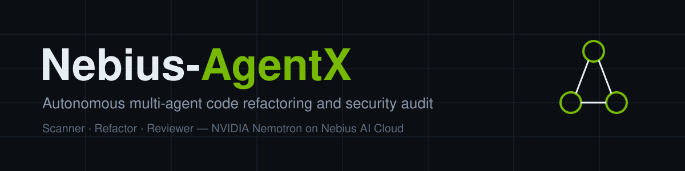

# Nebius-AgentX

**Autonomous multi-model code refactoring and security audit agent.** Point it at a GitHub repository, a local folder or a pasted file. Three agents find security and performance problems, write patches and verify them, using NVIDIA Nemotron models served on Nebius AI Cloud. You get a report, a side-by-side diff, a `git apply`-ready patch and, if you want, a pull request.

Track: Coding & Agentic Engineering (Autonomous Multi-Agent Systems), Nebius x NVIDIA Global AI Hackathon.

## The problem

Security review does not keep up with how fast code is written. Static analyzers flag problems but leave the fix to a developer, and many people treat their output as noise. A single LLM pass can write a fix, but nothing checks that the fix compiles, keeps the API intact or actually removes the vulnerability. Teams need findings that come with fixes they can trust.

## What it does

- **Scanner agent** combines 58 static rules covering 41 CWEs with Nemotron review of AST-aware code chunks to catch issues the rules miss. The Python engine resolves imports (`from os import system`, `import xml.etree.ElementTree as ET`) and tracks untrusted input from web requests, `input()` and route parameters through variables into dangerous calls. That covers SQL, command, path, LDAP, XPath, log and header injection, SSRF, open redirects, XSS and file uploads.
- **Refactor agent** applies deterministic AST-guided fixes for 10 rule families, then asks Nemotron to handle the rest: SQL injection, logic-level issues and anything needing context. It rejects model output that doesn't parse or that drops public functions.
- **Reviewer agent** verifies each patch: the diff applies cleanly, the code parses, public functions survive, the original findings are gone and no new ones appear. A model review is blended in to produce a confidence score. Patches below the threshold go back to the Refactor agent with feedback.
- **Outputs:** a Streamlit dashboard with a severity breakdown and side-by-side diffs, a JSON report, unified patches, a Git branch with a commit, and an optional GitHub pull request.

## How Nebius AI Cloud and NVIDIA models are used

- `src/nebius_client.py` wraps the OpenAI Python SDK's `AsyncOpenAI` and points it at the Nebius OpenAI-compatible endpoint (`NEBIUS_BASE_URL`).
- The primary model is **NVIDIA Llama-3.1-Nemotron-Ultra-253B** (`NVIDIA_MODEL_NAME`), with fallbacks to **Nemotron Super 49B** and **Llama 3.3 70B**. If a model returns 404 or 422, the client moves to the next one. Rate limits, timeouts and 5xx errors are retried with exponential backoff.
- Nemotron reasoning traces (`<think>…</think>`) are stripped before parsing. JSON replies are parsed from raw text, code fences or embedded objects, with one automatic repair request if parsing fails.
- A shared semaphore caps concurrent requests to Nebius (`AGENTX_MAX_CONCURRENCY`), so auditing a large repository doesn't trigger a flood of rate-limit errors.

Model IDs are configuration. Check the Nebius Token Factory model list for the exact IDs and base URL your account has access to, and set them in `.env`.

See [docs/ARCHITECTURE.md](docs/ARCHITECTURE.md) for the diagram and agent loop.

## Setup

Requires Python 3.11+ and Git (Git only for auditing remote repositories).

```bash
python -m venv .venv
.venv\Scripts\activate          # Windows (macOS/Linux: source .venv/bin/activate)
pip install -r requirements.txt
copy .env.example .env          # macOS/Linux: cp .env.example .env
```

Add your `NEBIUS_API_KEY` to `.env`. Without a key the app runs in offline mode: static rules, rule-based fixes and automated review only.

## Run

**Dashboard**

```bash
streamlit run app/main.py
```

Choose **Paste code**, click **Load vulnerable example**, then **Run Nebius Agent Audit**.

**Command line**

```bash
python -m src.cli examples/vulnerable_app.py
python -m src.cli https://github.com/owner/repo --apply --pr      # needs GITHUB_TOKEN
python -m src.cli . --offline --fail-on high                      # CI gate: exit 2 on High/Critical
```

Reports go to `agentx-report/` (`report.json`, `agentx.patch`, one patch per file).

**API**

```bash
uvicorn src.api:app --reload
curl -X POST localhost:8000/audit -H "Content-Type: application/json" -d "{\"source\": \"examples/vulnerable_app.py\"}"
```

Endpoints: `GET /health`, `POST /audit` (JSON report), `POST /audit/patch` (unified diff). Interactive docs are at `/docs`.

## Benchmark

The rule engine is measured against public, labelled datasets of vulnerable code. These results come from the static engine alone, with no model calls:

| | Baseline | Now |
| --- | --- | --- |
| [SecurityEval](https://github.com/s2e-lab/SecurityEval) (121 samples, 69 CWEs): correct CWE found | 12.4% | **69.4%** |
| SecurityEval: any finding | 16.5% | **80.2%** |
| [Bandit examples](https://github.com/PyCQA/bandit): vulnerable files caught | 20.3% | **84.7%** |
| Python standard library (278K lines): Medium+ alarms per 1,000 lines | 0.55 | **0.35** |
| Automatic fixes that break code, regress or overclaim | 0 | **0** of 258 |

Reproduce with `python -m bench.fetch_datasets` then `python -m bench.evaluate`. Details and the known disagreements with Bandit are in [bench/README.md](bench/README.md).

## Tests

```bash
pytest
```

There are 118 tests:
- **`tests/test_core.py`:** Nebius client parsing, retries, fallback and streaming; chunking; diffs; the full agent loop with a mocked model; the API.
- **`tests/test_rules.py`:** for every rule, a vulnerable snippet that must trigger it and a safe one that must not.
- **`tests/test_pressure.py`:**
  - mutation and fixer fuzzing;
  - pathological inputs, such as null bytes, 3,000-deep nesting and 500K-character lines;
  - a chaotic fake model that fails or returns garbage;
  - a 300-file concurrent load test.

## Project layout

```
src/            nebius_client, scanner, pyanalysis (taint + rules), rules, fixers, agent,
                orchestrator, diffing, repo, api, cli
app/main.py     Streamlit dashboard
bench/          dataset download, benchmark runner, results
tests/          pytest suite (core, per-rule golden tests, pressure tests)
examples/       deliberately vulnerable demo service
docs/           architecture and Devpost submission
```

## Limitations

- Deterministic fixes, taint tracking and AST checks are Python-only. Other languages get regex rules, model findings and model patches, verified by the diff and size checks.
- Taint tracking stays within a single function, so input passed through helper functions in other files is only caught by the model.
- Add `# nosec` or `# patchpilot: ignore` to a line you've reviewed and accepted.
- Automatic pull requests support GitHub remotes.
- Always review patches before merging. The confidence score shows how much verification a patch passed; it is not a guarantee.
