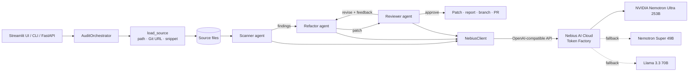

# Architecture

## Components

| Module | Role |
| --- | --- |
| `src/nebius_client.py` | `AsyncOpenAI` pointed at the Nebius base URL. Adds exponential-backoff retries for 429/5xx/timeouts, a model fallback chain on 404/422, a shared concurrency limit, streaming, `<think>` trace removal and tolerant JSON parsing. |
| `src/scanner.py` | File discovery, AST-aware chunking (Python splits on top-level definitions; other languages use overlapping windows) and a static rule engine of 21 rules mapped to CWE IDs. |
| `src/fixers.py` | AST-guided deterministic fixes for 10 rules (unsafe YAML, shell injection, weak hashes, hardcoded secrets, disabled TLS checks, mutable defaults and more). |
| `src/agent.py` | The three agents. Each one works on its own and adds model reasoning when a client is available. |
| `src/orchestrator.py` | Runs files concurrently and loops Refactor → Reviewer until the Reviewer approves or the pass limit is reached, keeping the best patch. |
| `src/diffing.py` | Unified diffs, a strict diff applier used for verification, side-by-side rows and HTML. |
| `src/repo.py` | Loads code, writes reports and patches, commits approved patches on a branch and opens GitHub pull requests. |
| `src/api.py`, `src/cli.py`, `app/main.py` | FastAPI service, command line, Streamlit dashboard. |

## The agent loop

1. **Scanner** runs the static rules, then sends each chunk with line numbers to the model and asks for findings that static analysis missed. Model findings are validated (line in range, known severity) and de-duplicated against the static ones.
2. **Refactor** applies deterministic fixes first, then gives the model the partly fixed file, the full list of findings and any Reviewer feedback. It accepts the model's file only if it parses.
3. **Reviewer** checks that the diff applies cleanly to the original, the result parses, public functions and classes still exist, the change is reasonably small, the static rules no longer fire on the fixed lines and no new findings appeared. It blends that score with a model review into a 0–1 confidence and a verdict: approve (≥ threshold), revise or reject.
4. If the verdict is not approve, the Reviewer's notes and the unresolved finding IDs go back to the Refactor agent for another pass.

## Offline mode

Without `NEBIUS_API_KEY`, every agent still runs: static rules, rule-based fixes and the automated review. That keeps the demo working without network access and gives the model a safer starting point when it is available.
